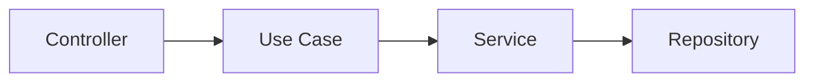

# Author
- [@fbotello-dev](https://github.com/fbotello-dev)

# Project description
Example of a Clean Architecture implementation using:
- Java 17
- Spring Boot 3.5.15
- JPA
- H2 Database
- ModelMapper

# Clean Architecture


# Structure of project
```text
src/         # Root of project
├── application/                # Layer of use cases (interfaces and implementations)
│   ├── usecase/
│       ├── impl/               
├── domain/                     # Model layer (enums, models, exceptions)
│   ├── exception/              
│   ├── model/                   
├── infrastructure/             # Infrastructure layer
│   ├── config/                 # Beans ans Classes of project configuration               
│   ├── controller/             # REST API services (request and response DTO´s)             
│   ├── persistence/            # Persistence layer
│       ├── entity/             # Data Object of persistence
│       ├── repository/         # Data Access layer             
│   ├── service/                # Business Logic layer
```
