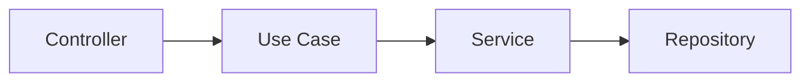

# Author
- [@fbotello-dev](https://github.com/fbotello-dev)

# Descripcion del proyecto
- Java 17
- Spring Boot 3.5.15
- JPA
- H2 Database
- ModelMapper
- SpringBootTest and Mockito

# Uso de arquitectura limpia


# Estructura del proyecto
```text
src/         # Root of project
├── application/                # Capa de casos de uso (interfaces and implementations)
│   ├── usecase/
│       ├── impl/               
├── domain/                     # Capa de modelos (enums, models, exceptions)
│   ├── exception/              
│   ├── model/                   
├── infrastructure/             # Capa de infraestructura
│   ├── config/                 # Beans ans Classes de configuracion               
│   ├── controller/             # REST API services (request and response DTO´s)             
│   ├── persistence/            # Capa de persistencia
│       ├── entity/             # Data Object cde persistencia
│       ├── repository/         # Capa de acceso a datos             
│   ├── service/                # Capa de logica de negocio
```


# Consideraciones

No tuve la condiciones tecnicas adecuadas para dar un mejor avance de la prueba, (maquina lenta y antigua). Me centre en realizar el codigo de manera 
mas simple, limpia y entendible. Con mayor tiempo hubiera podido cumplir con todos los requerimientos de la prueba. 

